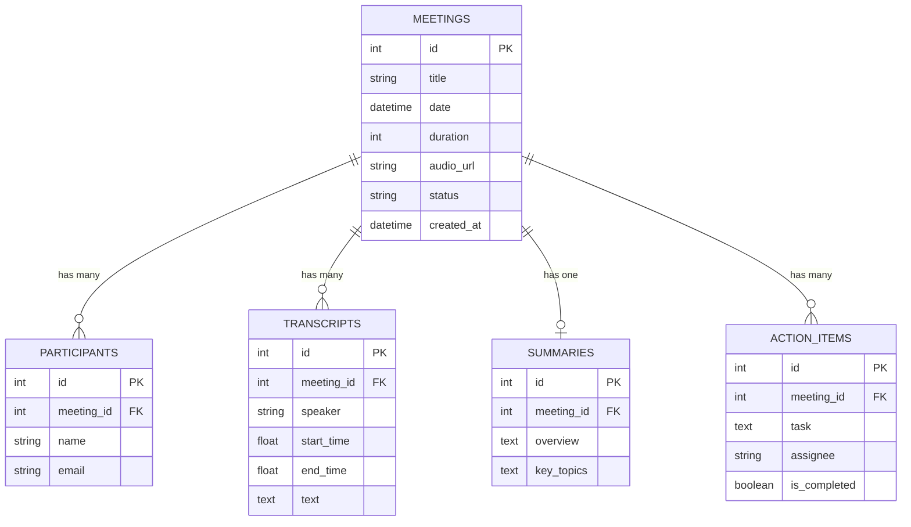

# Fireflies.ai Clone — Meeting Notes & Transcription Platform

A full-stack, pixel-perfect clone of the **[Fireflies.ai](https://fireflies.ai/)** meeting-assistant workspace. Built for the SDE Fullstack Assignment, replicating the core post-meeting workflows, signature purple visual design system, interactive audio seeking, AI note extraction, action item checklist management, and AskFred AI assistant.

---

## 🚀 Live Demo & Repository
- **Frontend App**: Next.js 16 (TypeScript, Tailwind CSS)
- **Backend API**: Python FastAPI (Uvicorn, Pydantic v2, SQLAlchemy)
- **Database**: SQLite with indexed relationships and cascade deletion

---

## 📸 Key Features Implemented

### 1. Meetings Library / Dashboard (Notebook)
- **Complete meetings inventory**: Title, formatted date, duration, attendees with colored avatar initials, and executive AI summary snippets.
- **Universal Multi-field Search**: Real-time instant filtering across meeting titles, AI summaries, key topic tags, transcripts, and attendees.
- **Filters & Sorting**:
  - Filter by lifecycle status: *All Meetings*, *Completed*, *Upcoming*, *Delayed*, and *Live*.
  - Filter by participant dropdown with dynamic counts.
  - Sort by *Newest First*, *Oldest First*, *Duration (Longest/Shortest)*, and *Title (A-Z)*.
- **Dual View Modes**: Seamless toggle between **Card/Grid View** and **Table/Row View**.
- **Metrics Header**: Real-time summary of total meetings recorded, total transcription hours, and completed vs. open action items.

### 2. Meeting & Transcript Detail View
- **Dual-Pane Split Layout**: Parity with Fireflies.ai workspace layout (Left: Notes & Deliverables; Right: Player & Transcripts).
- **Interactive Audio Player**:
  - Play / Pause controls with real-time waveform animation.
  - Interactive scrub seek bar with hover timestamps.
  - Skip -10s and Skip +10s quick navigation.
  - Playback speed multiplier (0.75x, 1.0x, 1.25x, 1.5x, 2.0x).
  - Volume slider and Mute toggle.
  - Web Audio fallback simulation for offline/sample playback continuity.
- **Synchronized Transcript Engine**:
  - Color-coded speaker avatar badges with distinct initials and roles.
  - Clickable timestamps: clicking any transcript row or timestamp seeks the media player to that exact second and starts playing.
  - Real-time active segment highlighting: glowing purple border and indicator synchronized with `currentTime`.
  - In-transcript search with instant keyword highlighting (marks matching terms in yellow/purple) and match count badge.
  - Speaker filter dropdown.
  - Micro-actions: Copy quote with formatted timestamp, and bookmark quote as Soundbite.

### 3. AI Summary, Notes & Action Items
- **Executive Summary**: High-level recap of meeting discussions and outcomes.
- **Key Topics & Outline**: Tagged discussion chapters with instant jump links that seek the player to the chapter start.
- **Interactive Action Items Checklist**:
  - Checkboxes to toggle tasks between completed and open (persists to SQLite database).
  - Assignee pills with `@mention` tagging.
  - Inline task creator to add new action items directly on the meeting page.
  - Delete task action with confirmation.
- **Speaker Analytics & Sentiment**:
  - Talk-time percentage distribution bars per participant.
  - Sentiment analysis breakdown (76% Positive, 22% Neutral, 2% Critical).
  - Words-per-minute cadence and inquiries logged.

### 4. Meeting Management (Full CRUD)
- **Create Meeting** (3-in-1 Creator Modal):
  1. *Form Entry*: Title, schedule, duration, attendees, summary, topics, tasks.
  2. *Upload / Paste Transcript*: Drop `.txt`, `.vtt`, or `.json` files or paste raw text; automatic regex parser extracts speaker names and start timestamps.
  3. *1-Click AI Meeting Templates*: One-click generators for *Sprint Retrospectives*, *Client Discovery Demos*, and *Strategy Syncs*.
- **Edit Meeting Metadata**: Edit title, date, duration, status, and manage attendees.
- **Delete Meeting**: With confirmation modal and animated toast feedback.

### 5. Bonus Features
- **AskFred AI Assistant**: Slide-out chat drawer where users can ask questions about the meeting, query decisions, request follow-up email drafts, and inspect sentiment.
- **Multi-Format Export**: Export meeting notes to Markdown (`.md`), Plain Text (`.txt`), JSON (`.json`), or Print/PDF format.
- **Dark & Light Mode**: Complete theme toggle with Fireflies royal purple accent palette (`#5832E6`) and deep slate dark mode (`#0B0D17`).
- **Placeholder & Bot Integrations**:
  - *Add Fred to Live Meeting*: Modal to dispatch Fireflies bot to Zoom, Google Meet, or MS Teams links.
  - *Apps & Integrations Hub*: Connected status for Zoom, Google Meet, Teams, Slack, Notion, and Salesforce.
  - *Settings Modal*: Notetaker rules, auto-join preferences, profile, and SOC2 security settings.
- **Toast Notifications**: Interactive toast alerts for every create, update, delete, copy, and export action.

---

## 📁 Manageable & Scalable Folder Structure

```
fireflies-clone/
├── backend/
│   ├── database.py           # SQLAlchemy engine, session maker & Base
│   ├── models.py             # Database models with cascade relationships
│   ├── schemas.py            # Pydantic v2 validation models
│   ├── crud.py               # Database queries, updates, and AskFred AI logic
│   ├── main.py               # FastAPI application, CORS, routers & endpoints
│   ├── seed.py               # Realistic dataset seeder (6 comprehensive meetings)
│   ├── fireflies.db          # SQLite persistent database file
│   └── requirements.txt      # Python dependencies
│
└── frontend/
    ├── app/
    │   ├── favicon.ico
    │   ├── globals.css       # Tailwind CSS v4 styling & scrollbars
    │   ├── layout.tsx        # Root HTML layout with system fonts & metadata
    │   ├── page.tsx          # Meetings Library / Dashboard view
    │   └── meetings/
    │       └── [id]/
    │           └── page.tsx  # Meeting Detail / Interactive Transcript view
    │
    ├── components/
    │   ├── layout/
    │   │   ├── Sidebar.tsx   # Fireflies left navigation & workspace stats
    │   │   └── Header.tsx    # Top navigation bar with universal search
    │   ├── meetings/
    │   │   ├── MeetingCard.tsx     # Grid card view
    │   │   ├── MeetingRow.tsx      # Table list view
    │   │   ├── AudioPlayer.tsx     # Media player with scrubber & speed control
    │   │   ├── TranscriptView.tsx  # Interactive transcript with seeking & search
    │   │   ├── SummaryPanel.tsx    # AI notes, topics & action items checklist
    │   │   └── AskFredPanel.tsx    # Slide-out AskFred AI assistant chat drawer
    │   ├── modals/
    │   │   ├── NewMeetingModal.tsx # Multi-mode meeting creator (Form, Upload, AI)
    │   │   ├── EditMeetingModal.tsx# Edit metadata & attendees
    │   │   ├── ExportModal.tsx     # Markdown, TXT, JSON, PDF export
    │   │   ├── LiveBotModal.tsx    # Send Fred bot to live meeting
    │   │   ├── IntegrationsModal.tsx # Apps & Integrations
    │   │   └── SettingsModal.tsx   # Workspace preferences
    │   └── Toast.tsx         # Notification toast provider
    │
    ├── lib/
    │   ├── api.ts            # Type-safe API client for FastAPI backend
    │   └── utils.ts          # Formatting, durations, timestamps & export helpers
    │
    ├── types/
    │   └── index.ts          # TypeScript domain interfaces
    └── package.json
```

---

## 🗄️ Database Schema Design

The SQLite relational database is designed with SQLAlchemy 2 with indexed lookups and cascade deletions:



---

## 🔌 API Endpoints Overview

| Method | Endpoint | Description |
|---|---|---|
| `GET` | `/api/meetings` | Retrieve list of meetings with search, participant & status filters |
| `GET` | `/api/meetings/{id}` | Retrieve single meeting with transcripts, summary, and action items |
| `POST` | `/api/meetings` | Create new meeting with nested relations |
| `PUT` | `/api/meetings/{id}` | Update meeting metadata (title, date, duration, attendees) |
| `PUT` | `/api/meetings/{id}/reschedule` | Reschedule meeting date and duration |
| `PATCH` | `/api/meetings/{id}/status` | Update meeting status (`completed`, `upcoming`, `delayed`, `live`) |
| `DELETE` | `/api/meetings/{id}` | Delete meeting and all cascaded child records |
| `POST` | `/api/meetings/{id}/action-items` | Add a new action item to a meeting |
| `PATCH` | `/api/action-items/{id}` | Toggle completion status of an action item |
| `DELETE` | `/api/action-items/{id}` | Remove an action item |
| `POST` | `/api/meetings/{id}/ask-fred` | Query AskFred AI assistant regarding meeting content |

---

## 🛠️ Getting Started / Setup Instructions

### Prerequisites
- Node.js (v18 or higher)
- Python (v3.10 or higher)

### 1. Backend Setup
```bash
cd backend

# Create and activate virtual environment
python -m venv venv
# Windows:
.\venv\Scripts\activate
# macOS/Linux:
source venv/bin/activate

# Install dependencies
pip install -r requirements.txt

# Seed the database with sample meetings, transcripts, and action items
python seed.py

# Start the FastAPI server (runs on http://localhost:8000)
uvicorn main:app --reload --port 8000
```
Swagger API documentation will be available at `http://localhost:8000/docs`.

### 2. Frontend Setup
```bash
cd frontend

# Install dependencies (if not already installed)
npm install

# Run development server
npm run dev
```
Open **[http://localhost:3000](http://localhost:3000)** in your browser.

---

## 💡 Assumptions & Design Decisions
1. **Transcription & AI Generation**: In accordance with the assignment guidelines, speech-to-text is seeded and user-importable via files or text rather than performing live audio compute.
2. **Audio Playback**: The media player supports real MP3 streams and includes an automatic simulation fallback to ensure scrubbing and seeking always function reliably without requiring external media servers.
3. **Optimistic Updates**: Action item status toggles update immediately in the user interface for responsiveness and sync asynchronously with the backend database.
